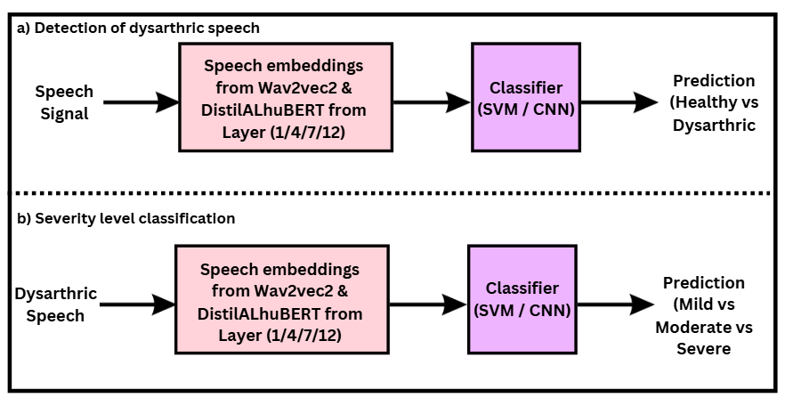

# Layer-wise SSL Embeddings for Multilingual Dysarthria Detection and Severity Classification

Which layer of a self-supervised speech model carries the most information
about dysarthria? This project extracts per-layer embeddings from
**wav2vec2-base** and **DistilALHuBERT**, trains SVM and MLP classifiers on
them, and compares layers 1, 4, 7 and 12 for two tasks: dysarthric vs.
control detection, and severity classification. It covers English
(UA-Speech, TORGO) and Tamil (TDSC).

Paper (ICON 2024): [ACL Anthology 2024.icon-1.74](https://aclanthology.org/2024.icon-1.74/)



## Datasets

The corpora are licensed and are not redistributed here. Obtain them from:

- **TDSC** — Tamil Dysarthric Speech Corpus, [LDC2021S04](https://catalog.ldc.upenn.edu/LDC2021S04)
- **TORGO** — [University of Toronto](https://www.cs.toronto.edu/~complingweb/data/TORGO/torgo.html)
- **UA-Speech** — [University of Illinois](https://speechtechnology.web.illinois.edu/data/)

## Pipeline

```
configs/<dataset>_<model>.yaml
        │
        ▼
python -m dysarthria.extract     manifest (path, label, speaker) →
                                 hidden states → mean-pool per layer →
                                 runs/<name>/layer_XX.npy + index.csv
        │
        ▼
python -m dysarthria.train       speaker-independent cross-validation,
                                 SVM and MLP, several seeds →
                                 results.json
```

```bash
pip install -r requirements.txt -e .

# 1. edit dataset.root (and speaker_regex for TDSC) in the config
python -m dysarthria.extract --config configs/torgo_wav2vec2.yaml

# 2. evaluate layers 1, 4, 7, 12 with both classifiers over 5 seeds x 5 folds
python -m dysarthria.train --features runs/torgo_wav2vec2 --layers 1 4 7 12 \
    --out runs/torgo_wav2vec2/results.json
```

Configs are provided for TORGO, UA-Speech and TDSC (wav2vec2) and TDSC
(DistilALHuBERT). DistilALHuBERT needs a clone of
[backspacetg/distilAlhubert](https://github.com/backspacetg/distilAlhubert)
and its checkpoint; set `model.repo_path` and `model.checkpoint`.

## Evaluation protocol

- **Speaker-independent splits.** `StratifiedGroupKFold` over speakers:
  no speaker appears in both training and test data. Every utterance needs
  a speaker ID, parsed with `dataset.speaker_regex`; a file that does not
  match is an error.
- **Repeated runs.** Every (layer, classifier) is evaluated over each seed
  × fold. Results report mean ± standard deviation of accuracy and macro
  F1, per-class precision/recall/F1, and the confusion matrix.
- **Leakage check.** `--split utterance` reproduces a random utterance-level
  split, so the two protocols can be compared on the same features.

Why this matters: dysarthria datasets have few speakers and many
utterances each. With a random utterance split, a classifier can score
highly by recognizing *voices* it saw in training. In the synthetic test
`test_utterance_split_is_inflated_by_speaker_leakage`, where labels carry
no information beyond speaker identity, a linear SVM scores **100%** with
an utterance split and **51% ± 18%** (chance) with a speaker split.

## Previously reported results

`results/` contains the accuracy tables from the original experiments
(layers 1, 4, 7, 12; SVM and MLP; up to 99–100% accuracy). The original
notebook, kept in `legacy/` for reference:

- split utterances with a random `train_test_split`, so the same speakers
  appear in training and test data;
- extracted only the final layer (`last_hidden_state`); the code that
  produced per-layer features is not in the repository;
- flattened each utterance's frame embeddings and kept the first 768
  values (the first frame) before classification, unless the separately
  defined time-averaging step was applied first.

Until the tables are regenerated with the speaker-independent protocol
above, treat them as speaker-dependent results.

## Classifiers

- **SVM**: linear kernel on standardized features.
- **MLP**: Dense 128 → Dropout 0.3 → Dense 64 → Dropout 0.3 → softmax,
  Adam, cross-entropy, 50 epochs (`src/dysarthria/mlp.py`). This is a
  PyTorch port of the Keras head in `legacy/mlp_head_keras.py`, which the
  original README called a CNN; it has no convolutional layers.

## Tests

```bash
pip install pytest
pytest -v
```

Synthetic-data tests (no corpora needed): manifest parsing for TORGO- and
UA-Speech-style layouts, layer pooling, speaker-disjoint folds, the
leakage comparison, both classifiers, and the training CLI. CI runs them
on every pull request.

## Repository layout

```
src/dysarthria/   manifest.py  extract.py  train.py  mlp.py  config.py
configs/          one YAML per dataset × model
tests/
results/          original result tables (see above)
legacy/           original Colab notebook and Keras head, for reference
docs/             block diagram
```
